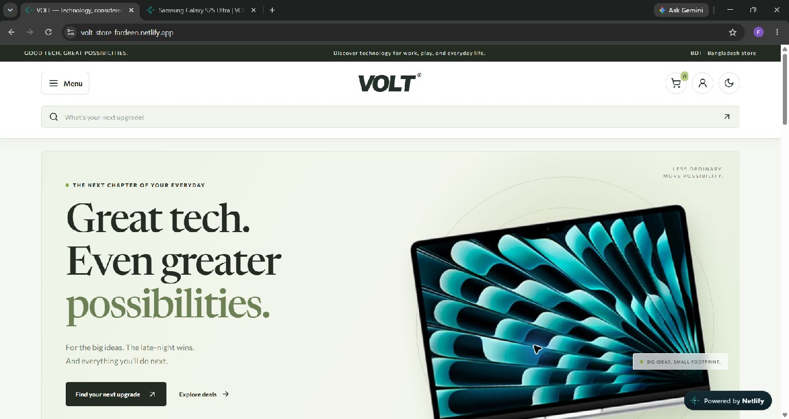
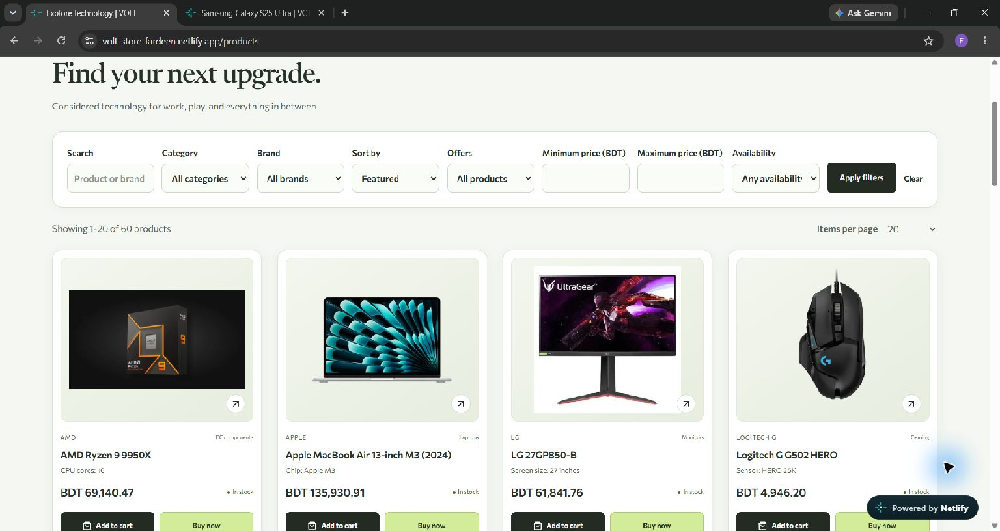

[**Visit the live VOLT store →**](https://volt-store-fardeen.netlify.app/)

# VOLT — Technology, considered.

A dedicated technology store website with a responsive shopping experience and a private dashboard for managing one shop.

**Project by [Fardeen Shah](https://github.com/Fardeen-Shah)**

## Preview

## Customer experience

- Responsive desktop, tablet, and mobile layouts with light and dark themes.
- Collapsible category navigation and search suggestions as you type.
- Product filtering, sorting, pagination, and adjustable items per page.
- Product photos, configurations, descriptions, specifications, and warranty details.
- Dedicated new arrivals, upcoming products, and deals collections.
- Shopping cart, wishlist, and product comparison.
- Customer accounts, profile settings, and saved delivery addresses.
- Step-by-step checkout with shipping selection, order review, and a payment modal.
- Order history, delivery tracking, returns, and warranty support.
- Contact form for customer inquiries.

## Store administration

- Product, brand, category, and specification template management.
- Product photo uploads and flexible product content.
- Inventory adjustments, stock alerts, and movement history.
- Order processing, fulfillment, and support workflows.
- Customer records and a contact inbox.
- Sales analytics, financial reports, and CSV exports.
- Staff permissions and administrative audit history.
- Editable store branding, logo, contact details, and opening hours.
- Private provider settings for payments, courier services, and email.

## Payment and delivery capabilities

Cash on delivery is available. Configurable connectors are built for bKash, Stripe card payments, PayPal, Pathao courier, and SMTP email. Live provider services require merchant credentials, provider approval where applicable, and final connection testing. Card wallets depend on processor and customer eligibility.

## Technologies

Next.js · React · TypeScript · Tailwind CSS · CSS Grid and Flexbox · PostgreSQL · Prisma · Better Auth · Netlify

## About this repository

This is a public portfolio showcase containing project information and screenshots. Application source code and private configuration are maintained separately.

For project inquiries, visit [Fardeen Shah's GitHub profile](https://github.com/Fardeen-Shah).
